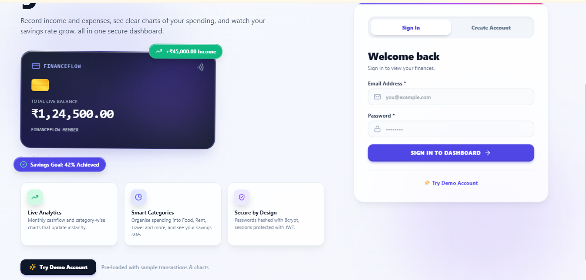
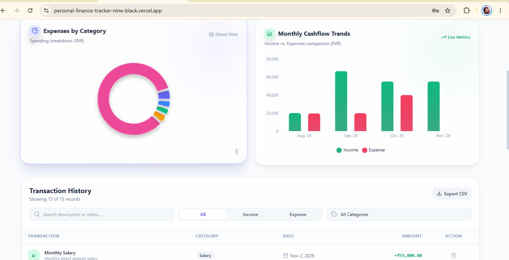
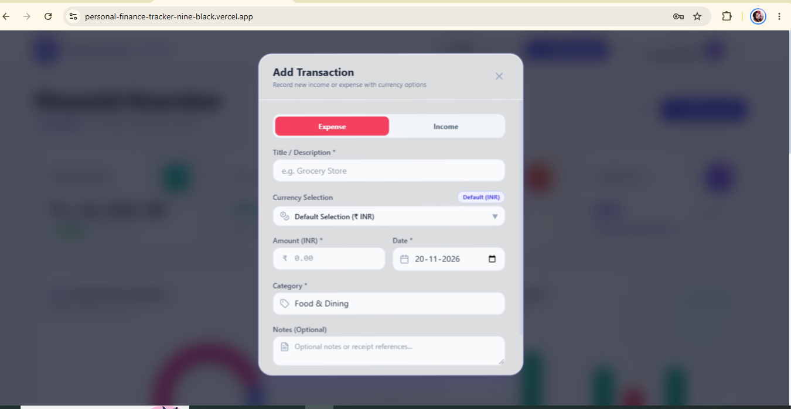
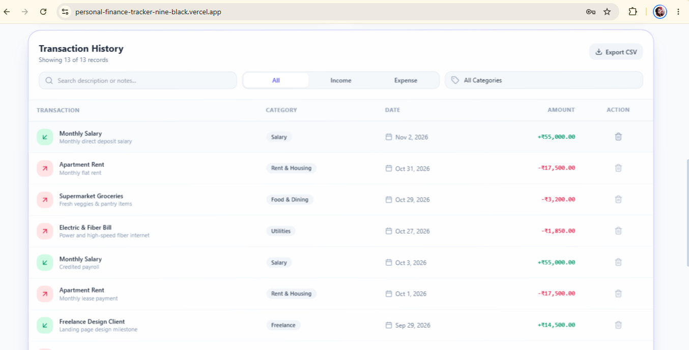
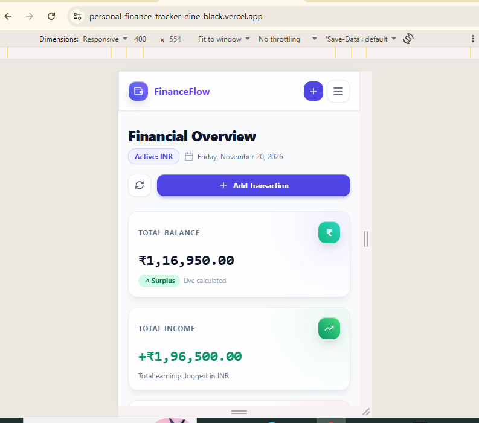

# 🧾 FinanceFlow — Personal Finance Tracker

A modern, full-stack personal finance web application built to help users record income and expenses, visualize spending patterns through interactive charts, calculate savings rates in real-time, and securely manage their financial records.


---

## 🌐 Live Demo

- **Frontend:** [https://personal-finance-tracker-nine-black.vercel.app/](https://personal-finance-tracker-nine-black.vercel.app/)
- **Backend API (Health Check):** [https://personal-finance-tracker-1btn.onrender.com/api/health](https://personal-finance-tracker-1btn.onrender.com/api/health)

> ⏳ **Note:** Backend runs on Render's free plan, so the first request after inactivity may take 30-60 seconds to wake up. Subsequent requests respond instantly.

---

## 📸 Screenshots

| 🖥️ Landing & Authentication | 📊 Financial Overview Dashboard |
| :---: | :---: |
| <br><sub>*Landing page with secure JWT sign-in, registration, and 1-click "Try Demo Account"*</sub> | <br><sub>*Real-time balance, income/expense summary cards, and interactive visual charts*</sub> |

| 💳 Add Transaction Modal | 📋 Filterable History & CSV Export |
| :---: | :---: |
| <br><sub>*Log income or expenses with custom categories, dates, and optional notes*</sub> | <br><sub>*Search by title/notes, filter by type or category, and 1-click CSV download*</sub> |

| 📱 Mobile-First Responsive Layout |
| :---: |
| <br><sub>*100% responsive design with mobile drawer, touch-friendly stacked transaction cards, and zero horizontal scroll*</sub> |

---

## 🎯 Key Features

- **🔐 Secure Authentication & Try Demo Account:**
  - User registration and login powered by JSON Web Tokens (JWT) and Bcrypt (10 salt rounds) password hashing.
  - **"Try Demo Account" Feature:** Instant 1-click exploration using a dedicated demo account (`demo@financeflow.com`). On every demo login, existing demo data resets and ~10 curated sample transactions are re-seeded across multiple months for realistic charts.
  - **Automated Demo Cleanup:** Demo transactions feature a 24-hour MongoDB TTL index that auto-deletes demo records without touching registered users' accounts.
- **📊 Real-Time Financial Summary Cards:**
  - **Total Balance:** Dynamic calculation with visual surplus or deficit indicators.
  - **Total Income:** Aggregated earnings logged in active currency.
  - **Total Expenses:** Aggregated spending recorded in active currency.
  - **Savings Rate (%):** Live percentage with an animated visual progress bar and recommended 30%+ benchmark.
- **📈 Interactive Visual Analytics (Recharts):**
  - **Expenses by Category:** Interactive Donut/Pie chart displaying proportional spending with custom currency tooltips and color-coded category badges.
  - **Monthly Cashflow Trends:** Grouped bar chart comparing income vs. expenses across historical months.
- **💳 Comprehensive Transaction Management (CRUD):**
  - Add Income & Expense transactions with Title, Amount, Category, Date, Currency, and Notes.
  - Instant live recalculation across all statistics, progress bars, and chart visuals upon any change.
  - Delete individual transaction records with confirmation dialogs.
- **🪙 Multi-Currency System:**
  - Full support for major global currencies (INR `₹` as default, USD `$`, EUR `€`, GBP `£`, JPY `¥`, CAD, AUD, etc.).
  - Centralized currency preference synchronized globally through React Context and formatted cleanly via `Intl.NumberFormat`.
- **🔍 Advanced Search & Filtering:**
  - Real-time text search across transaction titles and notes.
  - Filter by transaction type (`All`, `Income`, `Expense`).
  - Filter by category (`Food & Dining`, `Rent & Housing`, `Salary`, `Freelance`, `Utilities`, etc.).
- **📤 CSV Export:**
  - 1-click spreadsheet download generating clean `transactions_YYYY-MM-DD.csv` files based on the current filter criteria.
- **🌓 Dark & Light Mode:**
  - Fluid theme toggle with persistent preferences saved to browser `localStorage`.
- **🛡️ Production Abuse Protection & Security Limits:**
  - **Rate Limiting:** `express-rate-limit` prevents brute-force attacks (10 requests per 15 min on auth routes; 100 requests per 15 min on general API routes).
  - **HTTP Security Headers:** `helmet` applies OWASP-recommended HTTP response headers (HSTS, NoSniff, Frameguard, etc.).
  - **Request Size Limiting:** Strict `10kb` JSON payload limit via `express.json({ limit: '10kb' })` to mitigate memory denial-of-service.
  - **Storage Quotas:** Maximum 500 transactions per registered user and 30 transactions for demo accounts to preserve free-tier MongoDB Atlas capacity.
  - **Schema Validation:** Strict Mongoose constraints (title: 1-100 chars, notes: max 300 chars, amount: positive number up to 100,000,000, enum-enforced categories).
- **📱 100% Mobile Responsive Design:**
  - Tailored for all viewports from 360px mobile screens to large desktop monitors.
  - Mobile hamburger navigation drawer, stacked transaction cards on small devices, and React portal modals with scroll-locked backgrounds.

---

## 🧰 Tech Stack

| Layer | Technologies Used | Key Purpose |
| :--- | :--- | :--- |
| **Frontend** | React 18 (Vite), Tailwind CSS | Fast SPA rendering, component architecture, responsive utility styling |
| **Icons & UI** | Lucide React, Glassmorphism CSS | Crisp modern icons, subtle blur elevations, clean modal overlays |
| **Charts** | Recharts | Declarative SVG data visualizations (PieChart, BarChart, ResponsiveContainer) |
| **Client State** | React Context API, Axios | Global auth & currency state, JWT request/response interceptors |
| **Notifications**| react-hot-toast | Non-intrusive toast feedback for actions and server errors |
| **Backend API** | Node.js, Express.js | Scalable RESTful API, MVC architecture, custom middleware pipeline |
| **Security** | Helmet, express-rate-limit, Bcrypt.js | HTTP headers hardening, IP rate limiting, password salt hashing |
| **Database** | MongoDB Atlas, Mongoose | Cloud document database, schema validations, compound & TTL indexes |

---

## 📂 Project Structure

```text
personal-finance-tracker/
├── docs/
│   └── screenshots/             # Application preview screenshots
│       ├── login.png
│       ├── dashboard.png
│       ├── transactions.png
│       ├── add-transaction.png
│       └── mobile.png
│
├── client/                      # Frontend Application (React + Vite + Tailwind CSS)
│   ├── src/
│   │   ├── api/
│   │   │   └── axiosInstance.js # Axios instance with automatic JWT header attachment
│   │   ├── components/
│   │   │   ├── auth/
│   │   │   │   └── AuthPage.jsx # Landing page, Sign In, Sign Up & Demo login view
│   │   │   ├── common/
│   │   │   │   └── CurrencyModal.jsx # Portaled modal for selecting global currency
│   │   │   ├── dashboard/
│   │   │   │   ├── CategoryPieChart.jsx # Recharts expense breakdown by category
│   │   │   │   ├── MonthlyBarChart.jsx  # Recharts monthly cashflow trends
│   │   │   │   ├── StatCards.jsx        # Summary cards (Income, Expense, Balance, Savings)
│   │   │   │   └── TransactionTable.jsx # Mobile cards + desktop table + CSV export
│   │   │   ├── forms/
│   │   │   │   └── AddTransactionModal.jsx # Portaled modal for logging transactions
│   │   │   └── layout/
│   │   │       └── Navbar.jsx   # Responsive navbar with desktop pills & mobile drawer
│   │   ├── context/
│   │   │   └── AuthContext.jsx  # Authentication state & currency preference provider
│   │   ├── utils/
│   │   │   └── formatCurrency.js# Multi-currency formatting, symbols & currency list
│   │   ├── App.jsx              # Main Dashboard view & layout composition
│   │   ├── index.css            # Tailwind directives, custom scrollbars, animations
│   │   └── main.jsx             # React application entry point
│   ├── .env.example             # Frontend environment variables template
│   ├── index.html
│   ├── package.json
│   ├── tailwind.config.js
│   └── vite.config.js
│
└── server/                      # Backend REST API (Node.js + Express + MongoDB)
    ├── src/
    │   ├── config/
    │   │   └── db.js            # MongoDB Mongoose connection handler
    │   ├── controllers/
    │   │   ├── authController.js# Register, login, /me, demo login, currency preferences
    │   │   └── txnController.js # Transaction CRUD, summary calculations & categories
    │   ├── middleware/
    │   │   └── authMiddleware.js# JWT verification guard & route protection
    │   ├── models/
    │   │   ├── Transaction.js   # Transaction schema, compound indexes & demo TTL index
    │   │   └── User.js          # User schema & Bcrypt pre-save hashing hook
    │   ├── routes/
    │   │   ├── authRoutes.js    # /api/auth routes (with strict rate limiting)
    │   │   └── txnRoutes.js     # /api/transactions protected routes
    │   ├── seed.js              # Standalone demo data seed script
    │   └── server.js            # Express server initialization, helmet & rate-limit
    ├── .env.example             # Backend environment variables template
    └── package.json
```

---

## 🚀 Local Development Setup

Follow these steps to run the application locally on your machine.

### Prerequisites

- [Node.js](https://nodejs.org/) (v18 or higher)
- [MongoDB](https://www.mongodb.com/) (Local instance on port 27017 or a free MongoDB Atlas connection string)
- [Git](https://git-scm.com/)

---

### 1. Backend Setup

1. Open your terminal and navigate to the `server/` directory:
   ```bash
   cd server
   ```

2. Install dependencies:
   ```bash
   npm install
   ```

3. Create a `.env` file from `.env.example`:
   ```bash
   cp .env.example .env
   ```

4. Configure your `.env` variables:
   ```env
   PORT=5000
   NODE_ENV=development
   MONGO_URI=mongodb://127.0.0.1:27017/personal_finance_tracker
   JWT_SECRET=your_jwt_secret_key_here
   JWT_EXPIRES_IN=7d
   CLIENT_URL=http://localhost:5173
   ```

5. (Optional) Seed the demo account and sample records:
   ```bash
   npm run seed
   ```

6. Start the backend development server:
   ```bash
   npm run dev
   ```
   The backend API will run on **http://localhost:5000**. You can test the health endpoint at **http://localhost:5000/api/health**.

---

### 2. Frontend Setup

1. Open a new terminal and navigate to the `client/` directory:
   ```bash
   cd client
   ```

2. Install dependencies:
   ```bash
   npm install
   ```

3. Create a `.env` file from `.env.example`:
   ```bash
   cp .env.example .env
   ```

4. Configure your frontend `.env` variable:
   ```env
   VITE_API_URL=http://localhost:5000/api
   ```

5. Start the Vite development server:
   ```bash
   npm run dev
   ```
   The frontend will be accessible at:
   👉 **http://localhost:5173/**

---

## 🔑 REST API Reference

### Authentication Endpoints (`/api/auth`)

| Method | Endpoint | Description | Auth Required | Rate Limit |
| :--- | :--- | :--- | :--- | :--- |
| `POST` | `/api/auth/register` | Register a new user account | No | 10 req / 15 min |
| `POST` | `/api/auth/login` | Authenticate with email & password, receive JWT | No | 10 req / 15 min |
| `POST` | `/api/auth/demo` | Reset & log into the dedicated demo account | No | 10 req / 15 min |
| `GET` | `/api/auth/me` | Fetch currently authenticated user profile | Yes (Bearer Token) | 100 req / 15 min |
| `PUT` | `/api/auth/currency` | Update user's default currency preference | Yes (Bearer Token) | 100 req / 15 min |

### Transaction Endpoints (`/api/transactions`)

| Method | Endpoint | Description | Auth Required |
| :--- | :--- | :--- | :--- |
| `GET` | `/api/transactions` | Retrieve all user transactions (supports query filters) | Yes (Bearer Token) |
| `POST` | `/api/transactions` | Create a new income or expense transaction | Yes (Bearer Token) |
| `DELETE`| `/api/transactions/:id` | Delete an existing transaction by ID | Yes (Bearer Token) |
| `GET` | `/api/transactions/summary`| Compute balance, total income/expense, and charts data | Yes (Bearer Token) |
| `GET` | `/api/transactions/categories`| Get lists of supported income and expense categories | No |

---

## ☁️ Deployment Guide

This project is deployed using modern cloud platforms:

### 1. Database — MongoDB Atlas
- Hosted on a free **M0 Sandbox** cluster.
- Created a database user with read/write access.
- In **Network Access**, added IP address `0.0.0.0/0` (Allow access from anywhere) so that Render's dynamic outbound IP addresses can communicate with Atlas without interruptions.

### 2. Backend Web Service — Render
- **Platform:** [Render](https://render.com/) (Web Service)
- **Root Directory:** `server`
- **Environment:** `Node`
- **Build Command:** `npm install`
- **Start Command:** `npm start`
- **Environment Variables configured on Render:**
  - `PORT`: `5000` *(or default assigned by Render)*
  - `NODE_ENV`: `production`
  - `MONGO_URI`: `mongodb+srv://<username>:<password>@<cluster>.mongodb.net/personal_finance_tracker?retryWrites=true&w=majority`
  - `JWT_SECRET`: `<your_production_jwt_secret_key>`
  - `JWT_EXPIRES_IN`: `7d`
  - `CLIENT_URL`: `https://personal-finance-tracker-nine-black.vercel.app`

### 3. Frontend Static Site — Vercel
- **Platform:** [Vercel](https://vercel.com/)
- **Framework Preset:** `Vite`
- **Root Directory:** `client`
- **Build Command:** `npm run build`
- **Output Directory:** `dist`
- **Environment Variable configured on Vercel:**
  - `VITE_API_URL`: `https://personal-finance-tracker-1btn.onrender.com/api`

---

## 💡 What I Learned

Building FinanceFlow provided hands-on experience across the entire web application lifecycle:

- **JWT Authentication & Security:** Implemented token-based stateless authentication with expiration handling, Bearer tokens, protected Express middleware routes, and Bcrypt salted password hashing hooks.
- **RESTful API Architecture:** Structured maintainable Express controllers, separation of concerns, input sanitization, and structured JSON error responses.
- **MongoDB & Mongoose Modelling:** Designed relational document models using `ObjectId` references, created compound indexes (`{ userId: 1, date: -1 }`) for fast timeline queries, and leveraged MongoDB TTL (Time-To-Live) partial filter indexes for automatic data expiration.
- **React Context State Management:** Created unified global contexts (`AuthContext`) to share authentication credentials, user profiles, and active currency preferences across deeply nested components without prop-drilling.
- **Data Visualization with Recharts:** Translated raw database aggregations into intuitive, responsive SVG Donut and Bar charts with custom KaTeX-free tooltips and accessible color palettes.
- **Full-Stack Deployment & CORS:** Managed environment variables across split hosting providers (Vercel + Render + Atlas), handled cross-origin credentials, and accounted for cold-start wake-up latencies on free-tier services.
- **Abuse Prevention & Defensive Programming:** Hardened public APIs against common vulnerabilities using `helmet` security headers, `express-rate-limit` against credential stuffing, strict JSON payload size limits, and storage quotas to safeguard shared resources.

---

## 🔮 Future Improvements

- [ ] **Recurring Transactions:** Automated logging for recurring bills, rent, and subscriptions on specific calendar days.
- [ ] **Monthly Email Summaries:** Scheduled monthly financial health reports and savings highlights sent via email with Nodemailer.
- [ ] **Progressive Web App (PWA):** Offline service workers and mobile home screen installation for an app-like experience.
- [ ] **PDF Statement Export:** Generate clean, formatted monthly PDF statements with summary tables and embedded visual charts.
- [ ] **Category Budget Thresholds:** Set custom monthly spending limits per category (e.g. ₹5,000 for Dining) with alert warnings at 80% and 100% consumption.

---

## 👩‍💻 Author

**Kanchan Kumari**
- **GitHub:** [@kanchankumari211-web](https://github.com/kanchankumari211-web)
- **Role:** Full-Stack Web Developer

---

## 📄 License

This project is licensed under the **ISC License** — free to use for educational, personal, and portfolio demonstrations.
